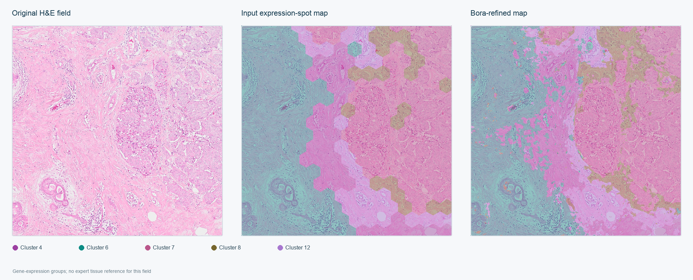
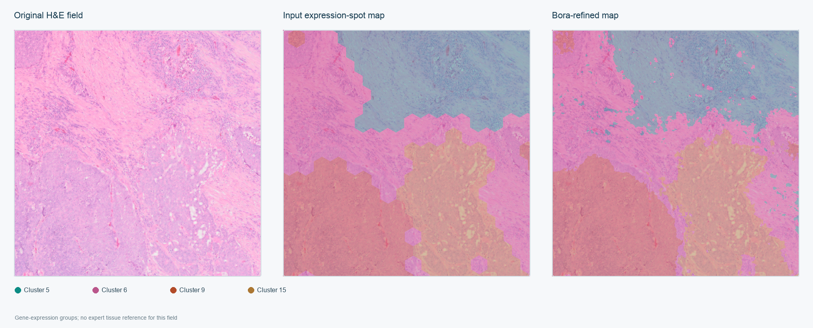

# Bora supporting results and resource audit

This report accompanies the CMPB draft. The source manuscript is `Bora_CMPB_manuscript_kodama_wsi.docx`. Its evaluation images had been inspected during development.

## Per-role support and final-mask agreement

| Role | Annotated images | Reference pixels | Mean IoU |
| --- | --- | --- | --- |
| tumor | 107 | 111,093,185 | 0.767 |
| in situ tumor | 7 | 3,750,640 | 0.678 |
| stroma | 110 | 118,636,758 | 0.704 |
| inflamed stroma | 23 | 3,629,493 | 0.638 |
| necrosis | 48 | 19,951,716 | 0.609 |
| normal glandular epithelium | 12 | 823,689 | 0.412 |
| epithelial tissue | 1 | 224,349 | 0.687 |
| blood | 32 | 808,122 | 0.045 |
| blood vessel | 24 | 1,979,596 | 0.117 |
| adipose | 10 | 3,275,910 | 0.370 |
| glandular secretions | 5 | 312,464 | 0.099 |
| lymphocytic infiltrate | 34 | 31,837,953 | 0.571 |
| other immune infiltrate | 3 | 2,764,128 | 0.000 |
| plasma cells | 9 | 9,588,306 | 0.351 |
| mucoid material | 1 | 61,615 | 0.000 |
| alveolar tissue | 2 | 255,138 | 0.407 |
| bronchial epithelium | 2 | 485,936 | 0.472 |
| cartilage or bone | 1 | 437,471 | 0.995 |
| inflammatory infiltrate | 9 | 1,069,739 | 0.166 |
| liver tissue | 2 | 2,691,876 | 0.967 |
| macrophages | 10 | 267,999 | 0.166 |
| mucus plasma or fluids | 1 | 9,220 | 0.000 |
| muscle | 11 | 2,489,766 | 0.701 |
| keratinized tissue | 1 | 18,862 | 0.000 |

## Later visually selected Visium fields

These fields were selected after H&E review and cluster merging. They are excluded from the prespecified primary-field summary in manuscript Table 5.

The original H&E sections are from the public 10x Genomics Visium releases for [breast cancer](https://cf.10xgenomics.com/samples/spatial-exp/2.0.0/CytAssist_FFPE_Human_Breast_Cancer/) and [colorectal cancer](https://www.10xgenomics.com/datasets/human-colorectal-cancer-11-mm-capture-area-ffpe-2-standard). The overlays and clustering colors are derived visualizations.

## Resource interpretation

The saved 116-image mean of 2.071 seconds used cached Virchow2 features and preceded the corrected ROI exporter. A four-ROI fresh-process pilot measured a 1.666-second median post-import time and 491-MB median peak resident memory, again using cached features. Neither is a cold encoder-inclusive time. Cold ROI and whole-slide timing and whole-slide peak memory require new runs.

The four-ROI pilot measured these median stage times (seconds): input loading 0.088, model loading/refit 0.019, RGB construction 0.238, appearance refinement 0.101, group pooling/context 0.114, fastPLS prediction 0.00009, GeoJSON export 0.979, and other run work 0.125. The full per-case measurements and timing contract are in [the resource record](../benchmark/cmpb_evidence/pipeline_resource_tiger_four.json). This post-import profile is not an end-to-end encoder benchmark.

The pending cold audit will measure one representative calibrated TIGER ROI and the colorectal WSI from process launch through final verified mask and vector. It will include image loading/resampling, Virchow2 checkpoint load and spatial inference, evidence construction, fastPLS startup fit, Bora refinement and vector export. A process-tree memory sampler will record peak host resident memory and GPU memory; results will be identified as hardware-specific. The Chiamaka GPU is currently occupied by the authorized Visium and multiscale feature queues, so this audit has not yet run.

The colon WSI output held 11,107,958 segments in a 202,959,745-byte GeoJSON. A measured in-memory gzip pass produced 30,243,402 bytes; the OME mask used 24,808,471 bytes. The vector is not compact compared with the compressed mask.
